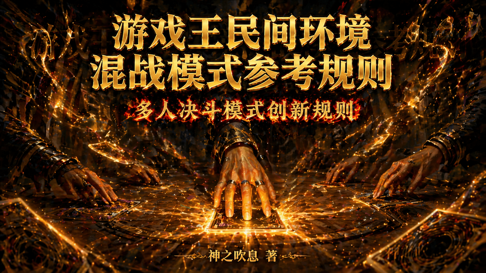

# 游戏王民间环境混战模式参考规则

[返回首页](../../index.html)

---

作者：神之吹息

版本：V1（初版）

首次发表日期：2026年10月21日

最后修改日期：2026年10月21日

# **前言**

**本文/视频参照CC BY（署名）协议开放转载，敬请保留原链接与作者信息噢~感谢传播！支持知识开放、协作与共享。**

欢迎各位读者姥爷看完后理性讨论，并支持各位读者姥爷**自定义规则**。

游戏王IP系列动画中，常见一些（类）BOSS战中存在多人决斗的剧情，或各自为战，或联合对抗BOSS等。无论如何，这些决斗有一定的观赏性，但KONAMI官方并未适时制定规则普及，乃至卡片设计也并未考虑到该部分。

据此，本人以408环境为基础，参考部分动画设定，研究出一套混战模式规则，供各位读者姥爷体验。部分机制参考、致敬了其他桌游的规则及其他玩家的类似灵感，希望这能带给各位读者姥爷不同于常规决斗的乐趣。

本文所述的混战模式（Battle Royal）参考了**《游戏王ARC-V》第24集《叛逆之翼 急袭猛禽》**的决斗构成，望能让各位读者姥爷体验到**铁之意志、钢之强韧**的决斗（笑）。

本文的部分专有名词，参照**《官方完全规则书（中文翻译）》**（https://ocg-rulebook.rtfd.io/）、**碎冰的规则整合**（https://ocg-rule.readthedocs.io/zh-cn/latest/index.html）。

# **目录**

1. 基础规则版本
2. 混战模式规则介绍
   1. 整体原则
   2. 行动顺序原则
   3. 细节规定（完善中）
   4. 落败玩家卡片处理
   5. 特殊胜利
3. 混战模式多人模式参考
   1. 基础玩法
   2. 变式玩法（欢迎微调、拓展！）
4. 后记

# **一、基础规则版本**

本文**未特别规定**的部分，适用日常决斗时使用的版本——无论是官方环境还是各种民间环境。

以408环境为例，即是“大师规则2020（不适用额外怪兽区）+2006年4月前卡池+2006年3月禁限卡表”。

当然，也可以不局限于408环境，比如结合[三战之才](../2.2026-6-26/2.2026-6-26.html)模式。

# **二、混战模式规则介绍**

省流版：多人混战，猜拳定顺序，每人第1回合不能抽卡、不能进入战斗阶段，之后正常。攻击可选任意对方，效果“对方”按上下文判定。落败玩家的卡离开游戏。详见下文。

## **1、整体原则**

混战模式暂只适用于**不适用额外怪兽区**的规则版本。

每名玩家的第1回合按照**基础规则版本的先攻第1回合规则**进行。

每名玩家之间**互为“对方”**，每名玩家**都行动过1个回合**称为“1轮”。

战斗阶段中，怪兽的攻击可以选择任意对方玩家的怪兽作为攻击对象，或者对任意没有怪兽的对方玩家直接攻击。

不建议适用**特殊胜利**。

> 以**408环境**为例，即每名玩家第1轮中**各自的第1回合不能抽卡、不能进入战斗阶段**。
> 也就是说，第2轮中最先能抽卡、进入战斗阶段的一般是**最先行动的玩家**。
> 当然，按照基础规则版本，初始基本分还是**8000**，初始手卡还是**5张**。

## **2、行动顺序原则**

玩家通过猜拳、掷骰子、抽签等方式决定自身的**行动次序**（俗称“X号位”）。

回合按次序进行，本轮最后一位玩家回合结束后，进入下轮首位玩家的回合。

按照行动次序，下一位行动的玩家称为“下家”，上一位行动的玩家称为“上家”。

最后一位玩家是首位玩家的上家，反之同理。

## **3、细节规定（持续完善中）**

### **（1）仅“场上”类文本**

只记述“**场上**”文本，一般指所有现存玩家的场。

- 例1：发动“激流葬”，破坏的是**所有玩家场上**的怪兽。
- 例2：发动“旋风”时，从**所有玩家的场上**任取1张魔法·陷阱卡为对象。
- 例3：发动“次元魔法”，适用破坏怪兽的效果时，逻辑和动作类似例2，只是规则上不需要取对象。
- 例4：发动“神鸟攻击”时，从**所有玩家的场上**任取2张卡为对象。

### **（2）“对方”单方类文本**

一般**进入连锁的效果**，记述有“**对方**”的文本，一般指某个（些）特定对方玩家。

1. 需要发动卡或效果的同时**确定具体的对方玩家**，然后才转移优先权。
   - 例1：发动“地碎”“闪电旋涡”时，需要在发动的同时确定破坏哪名对方玩家的怪兽，然后才转移优先权。
   - 例2：发动“沙尘之大龙卷”时，需要在发动的同时确定破坏哪名对方玩家的魔法·陷阱卡（可与取具体对象**同时进行**），然后才转移优先权。
   - 例3：发动“零式魔导粉碎机”的效果时，需要在发动的同时造成哪名对方玩家伤害，然后才转移优先权。
2. 如文本之间存在**明显关联性**，则上下文之间的“对方”玩家**必须是同一人**。
   - 例1：发动“次元壁”时，怪兽发动攻击宣言的“对方”与代替承受战斗伤害的“对方”必须是同一人。
   - 例2：“削魂的死灵”只能让**被直接攻击成功、受到战斗伤害**的那名“对方”玩家丢弃手卡。
   - 例3：“强夺”只能让**被夺取控制权**的那名玩家回复基本分。
   - 例4：攻击里侧守备表示“魔法神灯”的“对方”与被转移攻击为的怪兽的“对方”必须是同一人。
3. 部分**特定阶段·步骤中发动的诱发类效果**文本中的“对方”，是**作为回合玩家的对方玩家**。如果当前是**自己回合**，则改为适用1的规则确定具体的对方玩家。
   - 例1：“真实之眼”的只回复**作为回合玩家的对方玩家**的基本分（按照**作为回合玩家的对方玩家**判断是否存在魔法卡），但所有对方玩家把手卡持续公开。
   - 例2：“风之精灵 迦楼罗”在每名对方玩家的结束阶段都能发动效果，但只能变更**当前回合的对方玩家**的怪兽的表示形式。
   - 例3：“通灵外质体”发动效果的同时，由回合玩家**确定具体的（回合玩家来看的）对方玩家**，效果处理时给与该具体玩家伤害。

部分**无种类效果**文本中的“对方”，可以是**任意一名对方玩家**。

- 例1：“电子龙”在只有**任意名对方玩家**场上存在怪兽（自己场上不存在怪兽）的场合，都可以从手卡特殊召唤。
- 例2：“魔导电子巨人”只在自己场上的怪兽数量比**某一名对方玩家**场上的怪兽少2只以上的场合才能从手卡特殊召唤，即**不能跨玩家合计计算**。

部分**永续类效果、效果外文本、进入连锁但持续适用的**文本中的“对方”，是**所有对方玩家**。原则是**尽量规避频繁的适用玩家变化**。

- 例1：根据“灵灭术师 海空”的永续效果，**所有对方玩家**不能把**所有玩家**墓地的卡除外。
- 例2：“光之护封剑”在**所有对方玩家回合计算**的均至少3回合后的**最后一名满足条件的对方玩家**结束阶段破坏，期间所有对方玩家怪兽不能攻击宣言。
- 例3：根据“冲锋陷阵的队长”的永续效果，**所有对方玩家**均不能选择**所有玩家**其他的战士族怪兽作为攻击对象。
- 例4：“沉默剑士 LV5”不受**所有对方玩家**的魔法卡的效果影响。
- 例5：“神圣之魂”在**所有对方玩家**战斗阶段内让**所有对方场上**的怪兽的攻击力下降。
- 例6：“反怒的熊猫”根据**所有对方场上**的怪兽的数目上升攻击力。
- 例7：“古代的机械巨人”攻击的场合，**所有对方玩家**直到伤害步骤结束时魔法·陷阱卡不能发动。
- 例8：“催眠术”对**所有对方玩家**下次的各自回合，都不能把怪兽的表示形式变更。

只要记述的“对方”满足发动条件，**不需要增加其他限制**，即可以“援助他人”。其他限制仍需遵守。

- 发动“神圣防护罩 -反射镜力-”时，发动的玩家**可以不是被攻击的玩家**，但破坏的必须是攻击玩家的怪兽。
- 发动“阿努比斯的裁决”时，发动的玩家**可以不是被那张魔法卡破坏自身魔法·陷阱卡的玩家**，但破坏的必须是发动那张魔法卡的玩家的怪兽。

### **（3）“双方”“自己·对方”“互相”等多方类文本**

一般**进入连锁的效果**，记述有这类文本，一般指**自己与某个（些）特定对方玩家**。

1. 需要发动卡或效果的同时**确定具体的对方玩家，然后才转移优先权**。
   - 例1：发动“魂粉碎”的效果时，需要在发动的同时确定**与哪名对方玩家**除外互相墓地的怪兽，然后才转移优先权。
   - 例2：发动“手札对换”时，需要在发动的同时确定**与哪名对方玩家**进行交换，然后才转移优先权，但公开手卡是向所有玩家公开。
2. 记述**特定阶段·步骤**的这类文本，在**所有玩家的对应阶段·步骤中发动/适用**。
   - 例1：“通灵外质体”的效果在**所有玩家的结束阶段**均会发动1次，只对确定的1名具体对方玩家造成伤害。
   - 例2：“阿匹卜之化神”在**所有玩家的主要阶段**都可以发动。
3. 特别的，**有其他文本突破限制**的，即使是进入连锁的文本，依然**对所有玩家均适用**。
   - 例：“变形壶”“手札抹杀”的效果要求“有手卡的玩家”丢弃所有手卡，因而抽卡也是对所有玩家均适用。

部分**永续类效果、效果外文本、进入连锁但持续适用的**的这类文本，视为**所有玩家均适用**。

- 例1：“恶魔侦察者”的效果抽到的卡，是**所有玩家确认**。
- 例2：“人造人-念力震慑者”的永续效果，是**所有玩家不能**把场上的陷阱卡的效果发动。
- 例3：“黑魔术少女”根据**所有玩家墓地**“黑魔术师”“黑混沌之魔术师”的数量上升攻击力。
- 例4：根据“魔力之枷”的效果，**所有玩家**从手卡把卡召唤·特殊召唤·发动·盖放，都必须支付基本分。
- 例5：“群雄割据”对**所有玩家**均有种族种类的限制。
- 例6：发动“大寒波”后，**所有玩家**均不能有魔法·陷阱卡的效果使用以及发动·盖放。

### **（4）优先权转移**

相较于常规决斗，有以下微调。以下部分并非优先权转移的全部内容，请在常规决斗的基础上进行理解。

**①一般原则**

**从回合玩家开始**决定是否进行某些操作（如发动效果等），当回合玩家放弃优先权后，优先权转移到其**下家**，以此类推，一直到回合玩家的**上家**放弃优先权，继续回合玩家的回合进程。

**②特殊规定**

原则为**所有玩家都要依次决定一遍，但被直接影响的玩家优先排在其他玩家前面，而被直接影响的玩家内部依然是依次决定**，具体细节如下。

1. 如那个操作**不直接影响其他玩家**，则**从操作玩家起算的下家开始**决定是否发动效果等，并转移优先权，以此类推，一直到操作玩家的上家放弃优先权。
2. 如那个操作**直接影响其他玩家**（如攻击、取对象等），则在1的基础上，**优先让本次操作受到影响的玩家**排在从操作玩家起算的下家前决定是否发动效果等，并转移优先权。
3. 受到影响玩家2名以上的场合，**以操作玩家为起点，按那些受到影响玩家之间的上下家关系**，依此决定是否发动效果等，并转移优先权。
4. 受到影响玩家均放弃优先权后，以操作玩家为起点，其他玩家**未优先决定过**的，再按1处理。已经优先决定过的此时不再需要决定，即**无需重复询问**。
5. 处理完后会回到回合玩家的对应时点，尤其是在同一连锁块中，只要有人决定发动效果，则该连锁块中前面各连锁上的**其余未轮到玩家的决定权会被跳过**。
   - 例1：共5名玩家A、B、C、D、E依次行动，A以B、D场上各1张卡发动“神鸟攻击”，此时是**被直接影响**的B、D先依次决定是否连锁，然后才到**未被直接影响**的C、E依次决定是否连锁，**后续无需重新确定**B、D是否决定连锁。
   - 例2：例1中，若D决定连锁发动“王宫的通告”，此时无需再让C、E决定是否对A发动的“神鸟攻击”决定是否连锁，而是**从D的下家E开始**决定是否连锁发动其他卡或效果。实际上就相当于**跳过了C、E对A的“神鸟攻击”的连锁决定权**。

6. 全部玩家均放弃优先权后，继续回合玩家的回合进程。

7. **必发的诱发类、诱发即时类效果**不会被因此跳过，因具体与**优先度**相关。

**③优先度**

关于优先度的处理（即**同一时点多个诱发类、诱发即时类效果构成连锁的顺序**规则），在原有规则的基础上参照上文。

优先度可参考碎冰的规则整合的“同一时点发动多个诱发类效果”：https://ocg-rule.readthedocs.io/zh-cn/latest/c03/%E8%AF%B1%E5%8F%91%E7%B1%BB%E6%95%88%E6%9E%9C.html#id30 。

### **（5）落败玩家卡片、回合处理**

**①落败玩家持有且控制**

那些卡**全部离开游戏，不视为送去墓地或除外**等，尤其是不视为**因效果送去墓地、除外、离开场上**等。那些效果**未发动、未适用的全部不发动、不适用**；**已发动**进入连锁的仍会**占用时点**，是否继续适用参照**是否依赖落败玩家的卡或决定**的原则。

但视为**离开场上或其他区域**，其他玩家的卡或效果可以发动、适用。

- 例1：落败玩家持有且控制的“三眼怪”“异次元的侦察机”效果不能发动，已发动进入连锁的效果**不适用**（卡本身或卡组已不存在），仍会**占用时点**。
- 例2：以落败玩家控制的怪兽为对象的“拷问车轮”，会在落败玩家的卡全部离开游戏时**破坏**。
- 例3：墓地已发动的“阴间领路人”在适用前**持有玩家落败**的场合，效果处理时依然把**现有玩家**场上的对象怪兽破坏（**效果处理不依赖落败玩家**）。
- 例4：已发动的“地碎”在适用前**持有玩家落败**，效果处理时已确定的具体玩家场上守备力相同的怪兽2只以上的场合，效果不适用（效果处理**依赖落败玩家的决定**）。

**②落败玩家持有，其他玩家控制**

那些卡仍保留在控制者处，直至需要**归还持有者控制**（离开场上、控制权归还等）时，视为直接从控制者处离开。其余参考“落败玩家持有且控制”。

- 例：被“强夺”夺取了控制权的玩家落败后，那只怪兽依然继续存在，“强夺”由于依然存在会**继续发动**回复基本分的**必发效果**，但**不再对落败玩家适用**。

**③其他玩家持有，落败玩家控制**

那些卡**送去持有者墓地或除外**等，**正常发动、处理效果**，此处不作赘述。

其余参考“落败玩家持有且控制”。

- 例1：因落败而**送去现有玩家墓地**的“三眼怪”，会由该**现有玩家发动并适用其效果**。
- 例2：因落败而**送去现有玩家墓地**的“多尔·多拉”，**不能发动效果**。

**④落败玩家回合处理**

1. 若落败玩家**非回合玩家**，所有处理完成后，**继续回合玩家的回合进程**。
2. 若落败玩家为**回合玩家**，所有处理完成后，一般不等待本回合**其他阶段·步骤**结束，直接进入**落败玩家后面首个现存玩家**回合的抽卡阶段。**伤害步骤**例外，会经历完成的本次伤害步骤后再直接进入**落败玩家后首个现存玩家**回合的抽卡阶段，即不再无意义进入落败玩家的战斗步骤。
   - 例：A控制的“三眼怪”攻击其他玩家攻击表示的“天空骑士 珀耳修斯”后落败，**依然需要进入伤害计算后**，由“天空骑士 珀耳修斯”发动、处理效果后，再进入后面首个现存玩家回合的抽卡阶段。

**⑤战斗步骤的卷回**

若落败玩家为**原被攻击怪兽的控制者**，此时视为“**对方场上的怪兽数量发生变化**”，适用战斗步骤的卷回。

### **（6）特殊胜利**

因极少机会测试特殊胜利的胜率及平衡性，暂**不推荐玩家使用**特殊胜利卡组进行本规则的游戏。

但欢迎有兴趣的玩家自行尝试并分享数据、体验。

若坚持使用，本人建议在下文的团队模式中使用，且特殊胜利改为“**先确定具体的某个对方玩家落败，若此时团队不唯一，则玩家自身再落败**”。

# **三、混战模式多人模式参考**

多人模式及其变式多种多样、变化无穷，无需局限于本文举例，可以参考**其他桌游**的多人模式进行。

## **1、基础玩法**

玩家之间可以**随意决定团队的数目及团队规模**，当然也可以“**一人成队**”。

当决斗中只剩下**唯一未落败**的团队时，该团队决斗胜利。决斗结束。当然也可制定其他胜利条件。

尝试以此进行**跨表对决**，感受与[不对称组队决斗](../1.2026-6-21/1.2026-6-21.html)风味不同的BOSS战吧！

## **2、变式玩法（欢迎微调、拓展）**

### **（1）团队模式**

**①身份局**

身份的种类与规则由玩家确定，可参考其他桌游，本文暂不提供具体设计。

玩家尽量按照**自己身份（无论隐藏还是公开）的胜利条件**行动。

可以制定**身份之间互动的奖惩规则**。

在某个或某类身份达到胜利条件时，游戏结束。

**②2V2（非“组队决斗”）**

与**组队决斗**不同，这里的4名玩家以混战模式决斗，任意一个团队的2名玩家**均落败**，决斗结束。

行动顺序随意，但一般建议**梅花间竹**会更有游戏性。想连续行动的也可以参考“**A1→B1→B2→A2→A1→……**”的次序。

在某名玩家落败时，其队友**立刻**选择其中1项**补给规则**：

- 回复4000基本分。
- 抽2张卡。
- 回复2000基本分，抽1张卡。
- 放弃补给。

补给规则**不诱发或适用**对基本分变化、抽卡的效果，不受“**不能进行**”类效果的影响。

**③3V3**

敬请期待。

**④3V3（无退出机制）**

敬请期待。

### **（2）非团队模式**

**①杀上保下**

一般建议3人进行。

每人的胜利条件相同：在**上家决斗落败**的同时，保障**下家决斗不落败**。 

任意一名玩家达到胜利条件后，决斗结束。

2人以上同时决斗落败的场合，改为**唯一现存玩家**决斗胜利。决斗结束。

**②敬请期待**

# **后记**

本文V1版本历经数月断断续续写成，本文可以当作简易的规则书使用。

为减少规则争议，考虑的情况较多，框架亲自玩一次基本就懂了，具体细节可以简化为碰到了再查阅。

也欢迎各位读者姥爷提出意见、建议，并亲自参与微调、拓展各种玩法。

用决斗，给大家，带来笑容吧！