# 入门预组/比赛预组

[返回首页](../../index.html)

---

各预组参照[《民间环境推广迷思：为什么预组不需要满血强度》](../Tittle-Tattle/Tittle-Tattle.html)的精神构筑，强度会有限制。
图片下方一长串为卡组码，可复制粘贴到文本文档并修改后缀为YDK文件，放到deck文件夹中。百度贴吧、线上群也有单独的YDK文件提供，或通过打补丁的方式一并获取。
欢迎以下列预组为模板，修改出**属于你自己的卡组**！

# **入门预组**

## Good Stuff

> #main
> 70095154
> 18036057
> 88472456
> 84914462
> 78636495
> 31553716
> 63749102
> 4041838
> 76909279
> 39507162
> 87621407
> 10375182
> 74131780
> 26202165
> 23205979
> 16226786
> 47507260
> 45141844
> 31560081
> 19613556
> 26412047
> 34016756
> 66788016
> 67169062
> 71044499
> 72302403
> 79571449
> 81510157
> 97169186
> 5318639
> 14087893
> 45986603
> 70828912
> 4206964
> 44095762
> 53582587
> 56120475
> 60082869
> 77754944
> 97077563

## 不死族

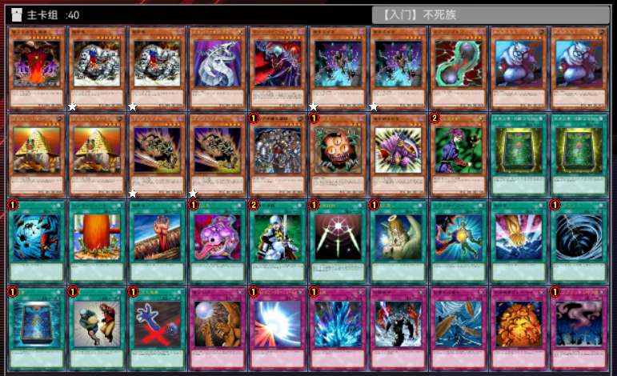

> #main
> 71200730
> 57281778
> 57281778
> 70095154
> 53839837
> 70821187
> 70821187
> 44436472
> 97017120
> 97017120
> 77044671
> 77044671
> 63665875
> 63665875
> 74131780
> 26202165
> 23205979
> 31560081
> 2204140
> 2204140
> 19613556
> 26412047
> 66788016
> 67169062
> 71044499
> 72302403
> 79571449
> 81510157
> 97169186
> 5318639
> 14087893
> 45986603
> 70828912
> 4206964
> 44095762
> 53582587
> 56120475
> 60082869
> 77754944
> 97077563

## 战士族

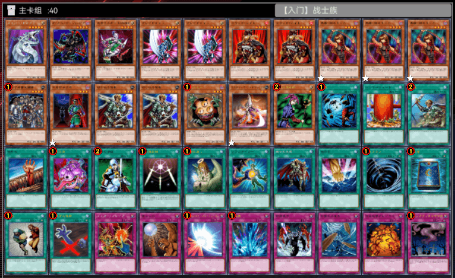

> #main
> 70095154
> 88472456
> 4041838
> 39507162
> 39507162
> 10375182
> 10375182
> 74153887
> 74153887
> 74153887
> 74131780
> 22609617
> 2460565
> 2460565
> 26202165
> 47507260
> 31560081
> 19613556
> 26412047
> 32807846
> 66788016
> 67169062
> 71044499
> 72302403
> 79571449
> 81510157
> 95281259
> 97169186
> 5318639
> 14087893
> 45986603
> 70828912
> 4178474
> 4206964
> 44095762
> 53582587
> 56120475
> 60082869
> 77754944
> 97077563

## 龙族

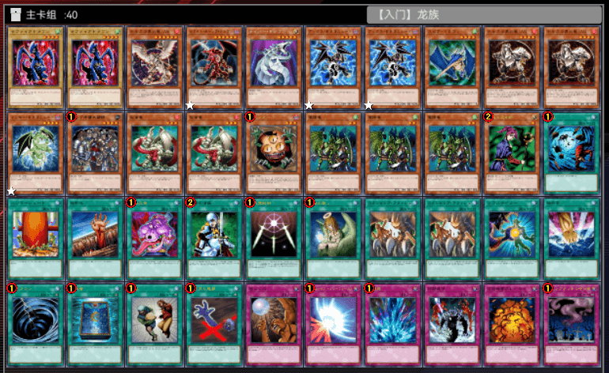

> #main
> 11091375
> 11091375
> 11224103
> 73891874
> 70095154
> 84914462
> 84914462
> 31553716
> 75830094
> 75830094
> 11125718
> 74131780
> 39191307
> 39191307
> 26202165
> 55013285
> 55013285
> 55013285
> 31560081
> 19613556
> 26412047
> 66788016
> 67169062
> 71044499
> 72302403
> 79571449
> 81385346
> 81385346
> 81510157
> 97169186
> 5318639
> 14087893
> 45986603
> 70828912
> 4206964
> 44095762
> 53582587
> 56120475
> 77754944
> 97077563

## 恶魔族

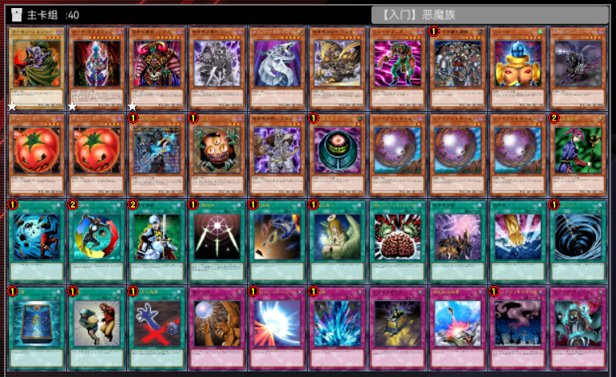

> #main
> 49881766
> 31829185
> 53982768
> 32619583
> 70095154
> 78004197
> 4335645
> 74131780
> 78636495
> 78700060
> 83011277
> 83011277
> 16226786
> 26202165
> 79126789
> 33508719
> 95178994
> 95178994
> 95178994
> 31560081
> 19613556
> 31036355
> 71044499
> 72302403
> 72892473
> 79571449
> 87910978
> 93554166
> 97169186
> 5318639
> 14087893
> 45986603
> 70828912
> 4206964
> 44095762
> 53582587
> 66742250
> 94192409
> 97077563
> 59344077

## 魔法师族

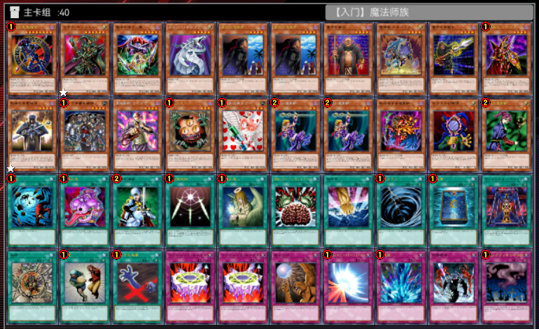

> #main
> 40737112
> 72630549
> 8034697
> 70095154
> 24317029
> 24317029
> 37101832
> 55424270
> 63695531
> 71413901
> 73752131
> 74131780
> 88240808
> 26202165
> 79575620
> 9156135
> 9156135
> 45141844
> 26376390
> 31560081
> 19613556
> 67169062
> 71044499
> 72302403
> 79571449
> 87910978
> 97169186
> 5318639
> 14087893
> 28553439
> 55713623
> 45986603
> 70828912
> 50755
> 50755
> 4206964
> 44095762
> 53582587
> 56120475
> 97077563

## 岩石族

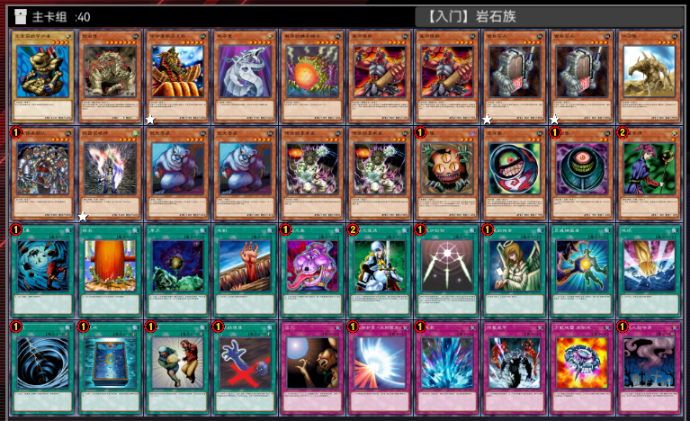

> #main
> 47879985
> 71544954
> 40659562
> 70095154
> 91862578
> 47606319
> 47606319
> 52323207
> 52323207
> 73648243
> 74131780
> 85489096
> 97017120
> 97017120
> 25773409
> 25773409
> 26202165
> 79106360
> 33508719
> 31560081
> 19613556
> 26412047
> 34016756
> 66788016
> 67169062
> 71044499
> 72302403
> 79571449
> 81510157
> 97169186
> 5318639
> 14087893
> 45986603
> 70828912
> 4206964
> 44095762
> 53582587
> 56120475
> 77754945
> 97077563

## 机械族

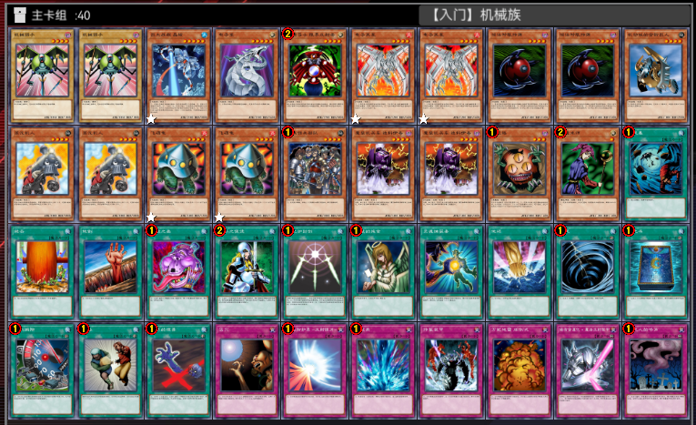

> #main
> 7359741
> 7359741
> 22790789
> 70095154
> 2851070
> 3370104
> 3370104
> 26302522
> 26302522
> 30190809
> 44729197
> 44729197
> 60806437
> 60806437
> 74131780
> 87621407
> 87621407
> 26202165
> 31560081
> 19613556
> 26412047
> 66788016
> 67169062
> 71044499
> 72302403
> 79571449
> 81510157
> 97169186
> 5318639
> 14087893
> 23171610
> 45986603
> 70828912
> 4206964
> 44095762
> 53582587
> 56120475
> 77754944
> 12503902
> 97077563

# **比赛预组**

## 混沌

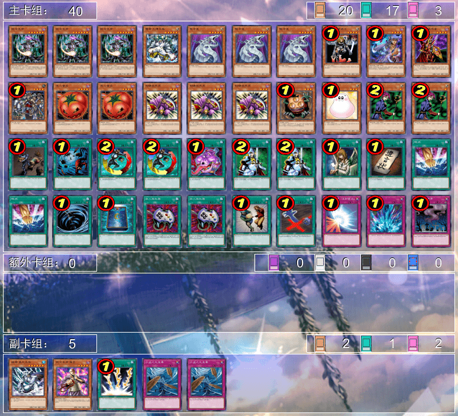

> #main
> 9596126
> 9596126
> 9596126
> 51945556
> 70095154
> 70095154
> 70095154
> 7572887
> 34853266
> 71413901
> 74131780
> 83011277
> 83011277
> 23205979
> 23205979
> 23205979
> 26202165
> 31305911
> 31560081
> 31560081
> 17375316
> 19613556
> 31036355
> 31036355
> 67169062
> 71044499
> 71044499
> 79571449
> 85602018
> 97169186
> 97169186
> 5318639
> 14087893
> 98045062
> 98045062
> 45986603
> 70828912
> 44095762
> 53582587
> 97077563
> #extra
> !side
> 4929256
> 88240808
> 69162969
> 60082869
> 60082869

## 不死族

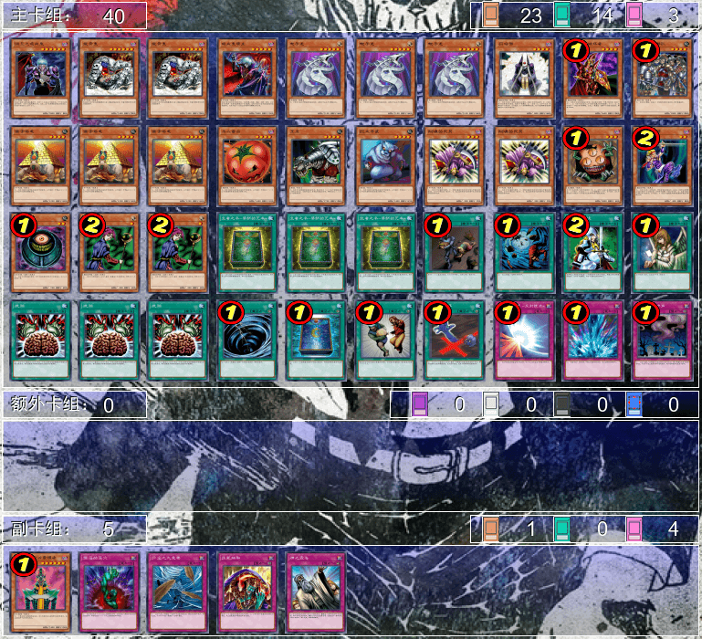

> #main
> 34294855
> 57281778
> 57281778
> 53839837
> 70095154
> 70095154
> 70095154
> 423585
> 71413901
> 74131780
> 77044671
> 77044671
> 77044671
> 83011277
> 83986578
> 97017120
> 23205979
> 23205979
> 26202165
> 9156135
> 33508719
> 31560081
> 31560081
> 2204140
> 2204140
> 2204140
> 17375316
> 19613556
> 71044499
> 79571449
> 87910978
> 87910978
> 87910978
> 5318639
> 14087893
> 45986603
> 70828912
> 44095762
> 53582587
> 97077563
> #extra
> !side
> 77585513
> 29401950
> 60082869
> 82732705
> 41420027

## 帝王

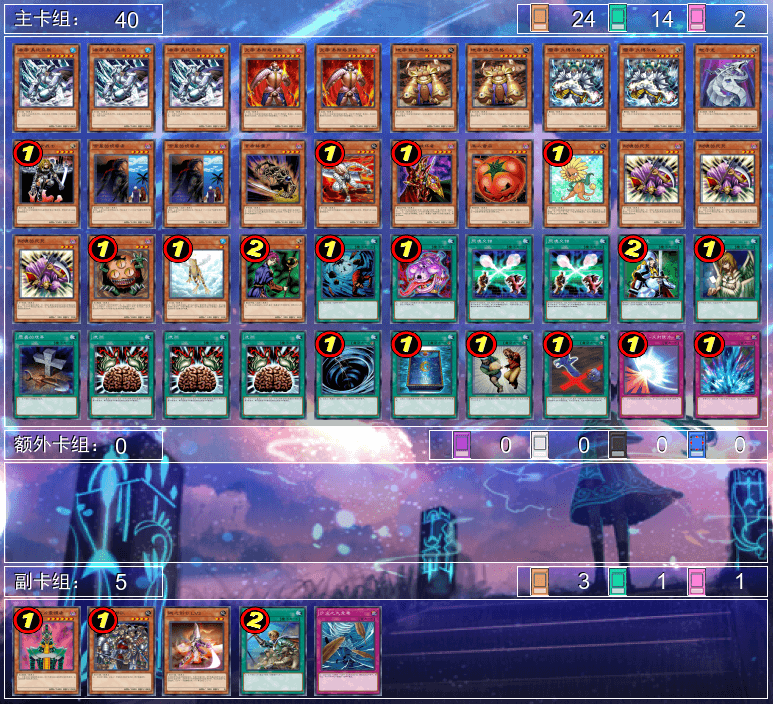

> #main
> 4929256
> 4929256
> 4929256
> 26205777
> 26205777
> 60229110
> 60229110
> 51945556
> 51945556
> 70095154
> 7572887
> 24317029
> 24317029
> 63665875
> 70074904
> 71413901
> 83011277
> 15341821
> 23205979
> 23205979
> 23205979
> 26202165
> 12538374
> 31560081
> 19613556
> 67169062
> 68005187
> 68005187
> 71044499
> 79571449
> 81439173
> 87910978
> 87910978
> 87910978
> 5318639
> 14087893
> 45986603
> 70828912
> 44095762
> 53582587
> #extra
> !side
> 77585513
> 74131780
> 47507260
> 32807846
> 60082869

## 零件

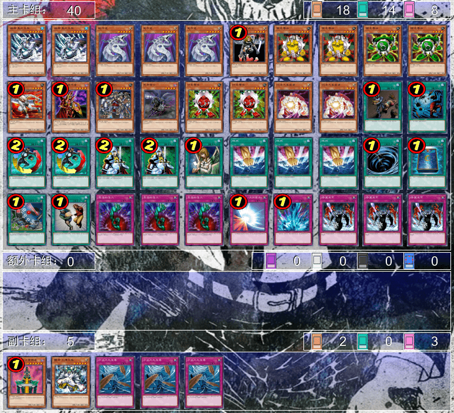

> #main
> 4929256
> 4929256
> 70095154
> 70095154
> 70095154
> 7572887
> 13839120
> 13839120
> 41172955
> 41172955
> 70074904
> 71413901
> 74131780
> 78700060
> 86445415
> 86445415
> 94853057
> 94853057
> 17375316
> 19613556
> 31036355
> 31036355
> 71044499
> 71044499
> 79571449
> 97169186
> 97169186
> 97169186
> 5318639
> 14087893
> 23171610
> 45986603
> 29401950
> 29401950
> 29401950
> 44095762
> 53582587
> 56120475
> 56120475
> 56120475
> #extra
> !side
> 77585513
> 51945556
> 60082869
> 60082869
> 60082869

## 地属性

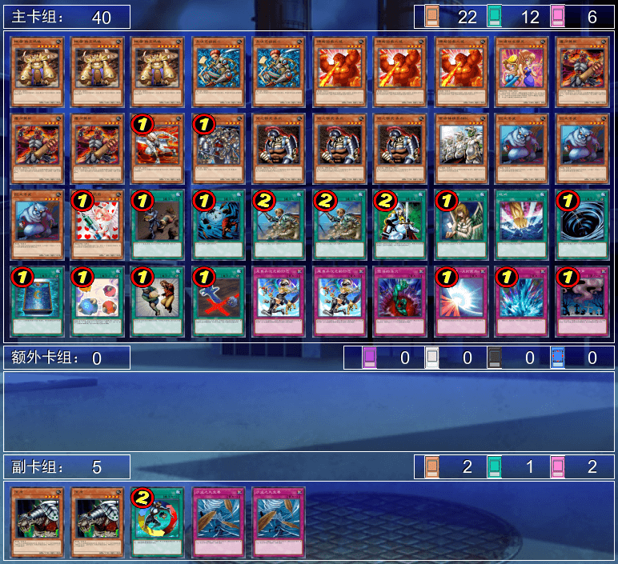

> #main
> 60229110
> 60229110
> 60229110
> 37043180
> 37043180
> 39168895
> 39168895
> 39168895
> 42386471
> 47606319
> 47606319
> 47606319
> 70074904
> 74131780
> 76305638
> 76305638
> 76305638
> 85306040
> 97017120
> 97017120
> 97017120
> 79575620
> 17375316
> 19613556
> 32807846
> 32807846
> 71044499
> 79571449
> 97169186
> 5318639
> 14087893
> 73915051
> 45986603
> 70828912
> 27174286
> 27174286
> 29401950
> 44095762
> 53582587
> 97077563
> #extra
> !side
> 83986578
> 83986578
> 31036355
> 60082869
> 60082869