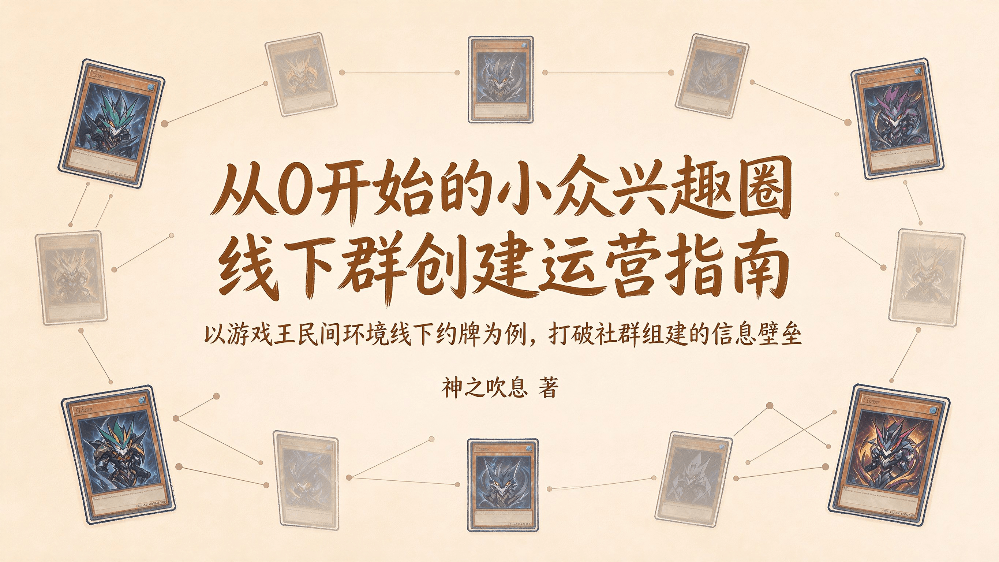

# 从0开始的小众兴趣圈线下群创建运营指南——以游戏王民间环境线下约牌为例，打破社群组建的信息壁垒

**本文/视频参照CC BY（署名）协议开放转载，敬请保留原链接与作者信息噢~感谢传播！支持知识开放、协作与共享。**

作者：神之吹息

版本：V1（初版）

首次发表日期：2026年10月10日

最后修改日期：2026年10月8日

[返回杂谈（仅供娱乐）](../Tittle-Tattle.html)

---

# **前言：致热爱与同好线下交流的你**

本文面向想要从零开始组织线下游戏王民间环境活动、但不确定从何入手的牌佬。

如果你正在阅读这篇文章，大概率属于以下几种情况之一：

- 你在线上群里找到了同好，但发现同城牌佬寥寥无几，更不知道如何把他们**聚到一起**。
- 你所在的城市明明有不少牌佬，却始终没有一个**稳定**的民间环境线下约牌组织。
- 你加入过一些本地群，但感觉**氛围被固定的小圈子主导**，新人很难融入，或者被各种“**人情**”绑住。
- 你只是想在自己所在的城市，**找几个同好**，安安静静地打几局民间环境的牌。

如果你有以上任何一种情况，这篇文章就是为你写的。

另外，本文虽以游戏王民间环境为例，但其中的**思路**，对**其他小众兴趣领域**的线下组织也有一定参考价值。

欢迎各位读者姥爷看完后理性讨论，也欢迎I人读者姥爷私信投稿。**私信、私聊投稿视为同意本人在展示投稿内容的同时展示头像及ID等信息实名收录到本文附加部分或新开设的包含“投稿-回应”类型内容的文章、视频**。如有深度理解，也欢迎**撰写长文公开对话、讨论**。

## **本文的定位**

### **这是一份行动手册，而不是一套教条**

以下内容中提到的各种做法，都是**参考建议**。你的**城市规模、已有的牌佬基础、可用的场地资源、你自己的时间和精力**，都会影响具体怎么操作。

你可以**根据实际情况来调整**，有些步骤可能不需要，有些步骤可能需要做得更细。

### **这是一份建设者的参考，而不是爱好者资格证**

本文不会暗示“组织线下活动是唯一正确的玩法”，也不会假设“不组织的人就不够热爱这个环境”。有些牌佬满足于线上打牌，有些牌佬觉得只跟极少数朋友决斗也很开心，这都完全没有问题。

本文不负责说服你“应该建群”，只是为那些**已经决定尝试**的人提供一个可以参照的起点。

### **这是一份关于“如何做事”的指南，也是一份关于“如何看待环境中的人际关系”的提醒**

现行的民间环境各有各的线上群，但线下活动往往集中在**少数城市、少数人**手中。

部分牌佬遇到的情况是：找不到同城局；或者找到了，但发现**圈子封闭、人情绑定严重**，参与门槛不在牌技上，而在“**你是谁的人**”。这种信息差和圈子壁垒，让一些本可以打牌的人，最终放弃了线下。

本文试图打破这种信息壁垒。从“如何找到同城牌佬”开始，到“第一次约牌怎么搞”，到“如何让群不冷场”，到“如何处理人际关系”，一步步拆解从零搭建线下打牌群的全流程。目标是**降低组局门槛**，让普通牌佬也能自主搭建**自由、纯粹**的线下决斗环境，推动民间环境生态的**去中心化**与**普惠化**。

比起某个城市只有极少数几个线下群“垄断”，如果能多一些线下群“自由竞争”互相**提升群员的决斗体验**，能让牌佬们**多一些自由选择**，既可以选择在少数线下群常驻，也可以雨露均沾**哪里有活动就去哪**——正如不少牌佬觉得比赛上位统计饼图中卡组类型更多一些、更**百花齐放**的民间环境更有可玩性一般。这样线下决斗的氛围和整体发展前景也会更好，不是吗？

当然，如果你现在玩得**开心**，**不需要改变任何事**。本文只是告诉你，如果你想做点不一样的，可以从哪里**开始**。

本文尾部附有一节关于城市人际环境的提醒（选读），不是教你如何对抗谁，而是让你知道：如果你遇到了类似的情况，那并**不是你的问题**。

# **目录**

1. 适用群体
2. 前期调查
3. 常用软件选择
4. 轻量试运行
5. 为新血作准备
6. 分享人生经验
7. 进阶方向
8. 特别篇：县城熟人社会
9. 附：城市陌生人人际环境提醒（选读）
10. 结语：从约牌开始，走到哪算哪

# **一、适用群体：谁能从本文中得到更多收获？**

你属于哪种情况？本文不要求你从头读到尾。不同起点的读者，可以直接跳到对应的章节。

## **情况一：一个人都没有，但想尝试线下实卡**

你还没找到同城牌友，也**不确定**所在城市有没有人玩民间环境。

**建议阅读重点：**

- 前期调查：怎么找同城牌佬。
- 常用软件选择：建群用什么工具。
- 轻量试运行：第一次约牌怎么搞。

**先找到一两个人，约一次牌**。不用一开始就准备很多东西。

## **情况二：有几位线上认识的同城牌友，但从未约过线下**

你们聊过卡组，说过“有机会线下打牌”，但从来没约成。大家都在**等别人先开口**。

**建议阅读重点：**

- 轻量试运行：怎么把“线上认识”变成“线下见面”，第一次约牌怎么定时间、选场地。
- 为新血作准备：想长期玩，可以准备公共预组。

你已经有了最宝贵的事物：几个有意愿的同城牌佬。你只需要**迈出第一步**。

## **情况三：已经有少数熟人约牌，但没有固定社群**

你们有两三个人会偶尔约牌，但每次都要临时找人、临时定时间。想过建群，又担心建了没人说话。

**建议阅读重点：**

- 常用软件选择：QQ群和微信群怎么选。
- 轻量试运行：怎么从随机约牌过渡到固定周常。
- 分享人生经验：长期维持群活跃度的方法。

你们已经过了“从零开始”的阶段。现在需要的是一个**能持续运转**的小框架。

## **情况四：群已经建了，但活跃度不高**

群内长期没人说话，约牌也约不起来。只有你在推动，其他人都在观望。

**建议阅读重点：**

- 轻量试运行：怎么重新激活一个冷场的群。
- 分享人生经验：冷场、无人说话时的处理思路，出现不同意见或小圈子倾向时怎么办。

群冷场不是你的错，也不是群没有价值。很多时候只是缺一个**合适的启动方式**。

------

此外，如果你属于以下情况，本文同样适用：

- 被简中“经典时光”等官方新品吸引，想**从经典环境入门**。
- 手里有几套卡组，想带新人入坑，**推广自己喜欢的经典民间环境**。
- 加入过本地群，但圈子封闭、人情绑定严重，想**搭建更平等自由的打牌环境**。
- 不一定想建大群，但想试试**组织小型的约牌或娱乐赛**。

本文不适用于**仅满足于线上打牌、对线下组织毫无兴趣**的牌佬。

本文不要求你已经有卡组，不要求你技术好，不要求你已经有圈子。你只需要有一个想法：“我想在自己所在的城市，找几个人，一起打打民间环境的牌”，然后愿意**迈出第一步**。

> **如果觉得线下没人组织，那你可以成为那个组织的人。**

# **二、前期调查：梭哈是一种智慧，一开始别乱来**

在决定建群之前，先花一点时间了解本地是否已经有人在做类似的事，以及同城牌佬大概有多少、在哪里。这一步不需要很复杂，但能帮你少走弯路。

## **1、精准存量排查：从线上群锁定同城牌佬**

这是最直接的方式。

- 在408、506、2011探索者环境等民间环境线上群中，用“**城市名**”搜索群成员列表，或者留意群昵称里带地名的群友（**需要群主和管理引导群员修改群昵称**）。如果群昵称没有地域前缀，可以在群内直接发一条“寻找XX城市牌友”的消息。
- 找到同城牌佬后，可以私聊问一句：“你在XX城市？有没有兴趣线下约牌？”不要一上来就提“建群”，用“约牌”做切入，对方压力更小。
- 如果对方没兴趣或没回复，不要追问，继续找下一个。

原则：明确身份，不绑定，不推销。**只是约牌，不是拉人**。

## **2、公域预热测试：用内容吸引潜在同好**

如果线上群里找不到足够的人，可以到**B站、小红书、贴吧、抖音、快手、NGA论坛、旅法师营地**等平台发内容。

- 内容方向：卡组分享、决斗录像、环境科普，或者简单一句“XX城市找民间环境牌友”等。
- 关键操作：标题、标签、简介里带上城市名。比如“广州408环境约牌”“茂名506环境找同好”“乌鲁木齐2011探索者环境一起来玩”。
- 观察反馈：有没有同城牌佬评论、私信？如果有，主动聊几句，确认对方是否真的想线下打牌。
- 大方得体：玩游戏王民间环境就是一个**很常规的爱好**，与打球、钓鱼、爬山、骑行、阅读、观影等没有本质的区别，宣传和交流时**大大方方**即可，无需提前害怕**普遍的公众**会有什么很**站得住脚**的负面看法。

核心逻辑：内容本身就是筛选器。能被你的内容吸引来的，往往是对环境有真实兴趣的人，比硬拉人靠谱得多。

## **3、本地生态初勘：了解场地与现有圈子**

在约第一次牌之前，先摸清本地有哪些**卡店、桌游吧**，或者适合打牌的公共场所（如经典的麦当劳、肯德基等快餐店，能容忍打牌的奶茶店、咖啡店等）。

- 看看哪些店有场地，收费如何、环境是否安静、交通是否方便。
- 顺便了解一下本地已有的游戏王圈子：是官方OCG、经典时光环境为主，还是也有民间环境牌佬？氛围如何？
- 不需要很详细，做到**心里有数**就行。

没有调查，就没有发言权。你需要获取足够的**情报**，才能有助于决定下一步。

## **4、不要急着建群：稳步推进才是硬道理**

以上三步做完，你大概能判断出：本地有没有**潜在牌佬**、大概有多少、他们愿不愿意线下打牌。

如果只有一两个人有意向，可以**先约一次牌**，约完之后再判断要不要建群。有时候不建群，大家反而更轻松。

如果一个人都找不到，也不用灰心。可以在公域平台继续发内容，慢慢积累。

或者换个思路：先去**附近城市**的线下活动看看（比如有些佛山牌佬偶尔会到广州来约牌。你可以留意附近城市的民间环境群，看看有没有类似的跨城约牌），学习经验，再回来做。

**先调查，再行动。** 不要因为一时冲动就建群，建了之后没人说话，反而打击信心。

# **三、常用软件选择：工欲善其事，必先利其器**

人找得差不多了，接下来就是建群。QQ群和微信群，选哪个？

先说结论：**QQ群当主阵地，微信群当辅助。**

## **为什么选QQ群当主阵地？**

**QQ群的优势：**

- 群文件能长期存卡表、规则、战报，新人进群自己翻。
- 群公告可以改，历史记录也能保留。
- 管理功能多，禁言、投票、作业都能用。
- 适合做“主群”，沉淀资料、发正式通知。

**微信群的局限：**

- 文件会过期，新成员看不到以前的聊天。
- 管理功能少，基本靠手动。
- 适合闲聊，不适合存东西。

**所以建议：**

- 用QQ群当**主群**，放资料、发通知、组织比赛。
- 如果大家平时更习惯微信，可以再建个**小微信群**，专门用来临时约牌、当天联络。但资料和正事还是回QQ群。

---

**总结：QQ群负责沉淀，微信群负责聊天。**

## **建群后的第一步：把“地基”打好**

群建好了，别急着拉一堆人。先把“地基”打好：

**群名要清晰**

建议格式：`【城市名】游戏王【环境名】线下约牌群`

比如：`【广州】游戏王408环境线下约牌群`

让人一眼就知道：这是哪个**城市**、玩什么**环境**、是干嘛的。

**群公告写三件事**

- 本群是干嘛的：比如“广州408环境线下约牌群”。
- 简单**群规**：文明交流、尊重不同玩法、禁止人身攻击。
- **鼓励约牌**：说一句“欢迎大家主动约牌，别光潜水”。

**设个简单的入群问题（可选）**

比如“你玩什么环境？”防止广告号乱入。群昵称也可以建议改成“城市（或者区县等）-昵称”，方便认人。

**先拉确认有意向的人**

建群后，先把之前确认**有意向**的那几个人拉进来。不用一下拉太多人，先把三五个**核心牌佬**聚起来。人少没关系，能约起来一次，就有第二次。

**群主别当甩手掌柜**

刚建群，没人说话很正常。你可以先发几句，比如“这周末有没有人想打牌？”“大家平时什么时间方便？”你**主动**一点，别人才敢开口。

---

**总结：QQ群当主阵地，微信群当辅助；群名清晰，公告写清楚，群主先主动。地基打好了，接下来就是第一次约牌。**

# **四、轻量试运行：千里之行，始于足下**

群建好了，人也拉了几个，接下来就是最关键的一步：**把人约出来。**

这一部分讲的是从“有群”到“有人来”的过程。第一次约牌怎么搞、约不到人怎么办、怎么从偶尔约变成固定约，一步步来，别想太复杂。

你不需要先成为一个“懂行的人”才能开始。很多事是**做了才会**，不是会了才做。第一次约牌，哪怕只是说一句“这周末有空吗”，就已经是在学了。

也不需要一次做完所有步骤。你只需要先做一件事：**找到一个人，约一次牌。** 其他的，等这一步做完了再说。

## **1、第一次约牌：目标不是办比赛，是聚起来**

第一次约牌，目的只有一个：让大家见个面，打上几局，觉得“下次还可以再来”。

- **人数**：2人就能打，3-4人最佳。先从之前确认有意向的那一两个人约起。不用等“人多了再搞”，**人少也能打**。
- **场地**：优先选**免费**或**低消费**的公共场所，比如经典的麦当劳、肯德基，奶茶店（确认不赶人、不扰民）。也可以去本地卡店，提前问清楚**有没有低消、要不要预约，营业时间如何**等。如果信得过，牌友家里也行，注意安全。
- **时间**：**周末下午**最合适。大家不用赶着上班，打完还能一起吃个饭。
- **实践**：在群里发一句“这周末有没有人打牌？地点XX，时间XX”，像朋友约饭一样随意。活动结束后**发几张照片**，配一句“今天打得很爽，下次继续”。这不是炫耀，是给没来的人一个信号：这个群**真的会约牌**。
- **进阶**：日后条件允许，还能拍摄简单的**日常约牌决斗录像**（只拍桌面部分），辅以简单的剪辑（只需剪去前后多余内容、适当加速、选些不算突兀的背景音乐等），不会剪辑也可以直接发原片，上传到B站、小红书、抖音、快手等视频平台，让更多的**潜在牌佬**看见。

## **2、没人回应：正常，别慌**

这是最可能出现的情况。群里一片安静，不代表你失败了，可能只是**大家还不熟、时间不合适**，或者**有人在观望**。

- **别在群里反复刷屏**，刷多了别人反而不敢说话。
- **一对一私聊**，找之前聊过的人单独问：“这周末有空吗？就我们俩先打打也行。”私聊比群聊有效得多。
- **降低门槛**，2个人就能打，打两局也行。

如果实在没人，可以先暂停，继续在公域发内容，或去附近城市的线下活动看看。等有新意向牌佬出现，**再试一次**。

## **3、持续约牌：别只靠你一个人**

约起来一次之后，关键是能不能约第二次、第三次。

- **固定时间地点**。比如每周六/日下午，某个多次去的合适场地，形成习惯。大家到点了就知道“该打牌了”，不用每次重新问。
- **鼓励群友自己发起**。筛选出3-5个稳定活跃的核心牌佬，不要每次都你当发起人。有人问“周末有人吗？”，你就积极回应，让他觉得“我也能组织”。

## **4、从约牌到小比赛：等稳定了再说**

如果约牌已经稳定了几次，有几位牌友常来，就可以试试搞个小型的**内部娱乐赛**。人数不用多，**4-8人**就够；规则简单点，瑞士轮打几轮；奖品可以是一包卡、一杯奶茶，重点是让大家有“**正式打一次**”的感觉。

办小比赛的目的，是让参与者有**仪式感**和**归属感**，也为以后办更大的活动积累经验。

可以参考一些已有的**比赛流程SOP**（报名、瑞士轮排表、战报发表等），不用太严格，灵活调整就行。

> [一种游戏王赛事SOP：从筹备到战报的全流程标准作业](https://www.bilibili.com/opus/1198786803293749266)
> [一种游戏王赛事改良瑞士轮赛制：分组瑞士轮实战指南](https://www.bilibili.com/opus/1200642220540035121)
> [比赛举办公告参考模板](https://www.bilibili.com/opus/1203239816784773140)
> [比赛报名表问题选项参考模板](https://www.bilibili.com/opus/1201755471799648296)
> [比赛战绩表问题选项参考模板](https://www.bilibili.com/opus/1204724153151651841)
> [比赛战报参考模板](https://www.bilibili.com/opus/1206208498166136841)
> [一种瑞士轮计分的细化方法：让每一分都掷地有声](https://www.bilibili.com/opus/1207692834591735808)

内部比赛也稳定之后，可以试试办一场稍微正式一点的**公开赛**。

---

**总结：从有群到有人来，关键就一件事：先约起来。约不到人，就私聊、换时间、多试几次；约成了，就固定时间、固定场地，慢慢形成习惯；稳定了，就试试搞个小比赛。一步一步来，不用急。**

# **五、为新血作准备：让新人也能轻松加入**

群稳定了，有人常来了，接下来可以考虑一件事：**让新人也能轻松加入。**

很多对民间环境感兴趣的人，不是不想玩，而是不知道怎么组卡。你让他自己收一套，他可能连从哪里开始都不知道。所以，准备几套**公共预组**，是降低新人门槛最直接的办法。

## **1、公共预组是什么？**

就是几套现成的卡组，放在群里，谁想玩谁拿去用。

- **降低门槛**：新人来了，不用收卡，直接拿一套就能打。资深牌佬想换环境试试，也可以借来玩。
- **统一强度**：预组之间强度相近，避免新人被资深牌佬碾压。
- **吸引观望者**：有人观望，让他先试一把，比说一百句都管用。

核心目的：**把“想玩”和“能玩”之间的门槛降到最低。**

## **2、预组怎么做：两种方案**

### **方案一：白条/打印版（成本最低）**

- 把卡图打印在A4纸上，剪下来，套上卡套，就能用。或者到淘宝搜索印制厚卡的服务。
- 适合学生党，或者作为公用试玩卡组。
- 可以使用中文卡图，规避外语的“语言障碍”。
- 缺点：手感差一点，但打牌完全没问题。

### **方案二：低价实卡版（体验最好）**

- 很多经典卡因为复刻，价格很便宜。一套入门级实卡卡组，**100-200元甚至更低**就能搞定。
- 可以请有经验的资深牌佬帮忙组，选操作简单、强度相近的卡组。
- 可参考408环境的**开源分级预组**（入门、比赛），直接抄作业。

建议：先做2-3套打印版试水，确认有人用，再升级实卡版。

## **3、预组怎么选？**

选预组卡组，记住四个原则：

- **匹配核心环境**：如果你们主要玩408环境，就选408的卡组，别整别的。
- **操作简单**：新手能快速上手的，别搞复杂combo。
- **造价低廉**：卡源充足、容易收，补卡不心疼。
- **覆盖不同风格**：最好有beat down、combo、OTK等各一套，让新人选自己喜欢的。

## **4、预组怎么管：别让它变成“公地悲剧”**

公共预组最容易出的问题是：**借了不还、弄坏了没人管、用着用着就没了。**

几个简单规则：

- **指定专人保管**：最好是你或某个靠谱的核心成员。
- **登记借还**：简单记一下谁借了、什么时候还。
- **明确使用规则**：比如“仅限群内活动使用”“损坏照价补”等。
- **接受捐赠**：有人愿意捐卡、捐卡套，欢迎。慢慢扩充物资库。

不用搞得太复杂，一个本子或一个共享文档就能管。

## **5、还可以准备什么**

除了卡组，这几样东西也能大幅提升新人体验：

- **基础配件**：备用卡垫、骰子、指示物、通用卡套。
- **科普物料**：打印版简化规则、环境禁限卡表、入门卡组玩法介绍。

这些东西花不了多少钱，但能让新人觉得“这个群挺专业、挺用心”。

---

**总结：准备几套公共预组，让新人不用收卡就能打。先做打印版试水，再升级实卡版。门槛降下来了，新血自然就来了。**

# **六、分享经验：有必要告诉你一些，人生的经验**

群建好了，人也约起来了。接下来是怎么让它活下去，而不只是热闹一阵子。这一部分不讲大道理，只讲一些可能遇到的问题和可以参考的应对方式。

## **1、约局：固定+灵活**

- **固定周常局**：比如每周六下午，固定时间、固定场地。大家到点了就知道该打牌了，不用每次重新问。
- **灵活临时局**：群友想打牌，随时可以在群里喊一声。不要每次都你当发起人，鼓励大家自己约。
- **人数兜底**：核心成员尽量保底到场。哪怕只有两三个人，也能打起来，不至于冷场。

## **2、怎么让群友自己发起约牌**

如果每次都是你发起约牌，你累，群也长不大。目标是让群友自己约。

**几个做法：**

- **公开鼓励**：“大家想打牌直接在群里喊就行，不用等我。”
- **积极回应**：有人发起约牌，你第一时间回应“算我一个”。哪怕你那天没空，也可以说“这次去不了，下次一定”。
- **不抢风头**：有人发起约牌，让他来定时间地点，你别急着替他安排。他组织了一次，下次就敢组织第二次。
- **给点小激励**：谁约成了，你在群里公开说一句“感谢XX组织”。简单一句话，比什么都管用。

## **3、氛围：平等、开放**

- **不搞技术鄙视链**：新手打错了，别嘲讽。谁都是从新手过来的。
- **不搞小圈子**：别让群变成几个熟人抱团、新人插不上话的地方。**主动回应新人**，拉他们一起打。
- **新人有人带**：新人进群，安排个资深牌佬一对一答疑带练，让他快速融入。
- **底线要明确**：禁止引战、辱骂、恶意利用规则。**该说清楚就说清楚**。

## **4、冷场了怎么办**

这是最常见的问题。群建好了，约了几次牌，然后慢慢没人说话了。

**先判断原因：**

- 是大家太忙，还是群本身没有吸引力？
- 是没人发起，还是发起了没人回应？
- 是核心牌佬流失了，还是新人没接上？

**几个可以做的事：**

- **群主先开口**。不用每次都聊打牌，聊聊新卡、比赛、环境都行。你开口了，别人才敢接。
- **私聊核心牌佬**。问问他们最近忙不忙、什么时候有空。有时候他们只是忘了，或者等你先开口。
- **降低活动门槛**。不一定要凑齐4个人，2个人也能打。不一定要打一下午，打两局也行。
- **接受冷场是常态**。群不会永远热闹。有时候冷一段时间，到了假期或新卡发售，又会热起来。不用因为冷场就否定自己。

## **5、出现争议怎么办**

群里有人吵架，或者对规则、玩法有不同意见，很正常。关键是别让争议变成分裂。**你建的群，你有权维护它的氛围。**

**几个原则：**

- **不强迫站队**。你是群主，不是裁判。**不要逼群友选边**，也不要让他们觉得“不表态就是敌人”。
- **对事不对人**。讨论规则可以，人身攻击不行。如果有人开始**阴阳怪气、翻旧账**，及时叫停。
- **给替代方案**。如果有人坚持“XX规则更好”等，不要和他争，直接说“你可以自己建个**分支群**试试，我们不拦着”。这比辩论有效得多。
- **保护少数意见**。有人提不同玩法，哪怕你不认同，也让他把话说完。也许他说的是错的，但让他说完，比让他闭嘴好。

## **6、玩法：保持新鲜感**

- **常规局为主**：大家玩什么环境，就约什么环境。
- **偶尔搞点娱乐局**：比如[三战之才跨环境对决](https://www.bilibili.com/opus/1218061169077518336)、[不对称组队赛](https://www.bilibili.com/opus/1216150192115417088)、自定义禁卡表娱乐局。不用多，一个月一次就行。
- **每月一次小型主题赛**：设置小额奖励（卡包、饮品免单等），提升参与感。
- **鼓励群友提新玩法**：有人想试什么，就让他组织一次。玩得好就保留，玩不好就算了。

## **7、口碑：让更多人知道**

- **每次活动后发战报、合照**：发在群里，也发在本地内容平台。这不是炫耀，是让外面的人知道“**这里有人在打牌**”。
- **鼓励群友邀请朋友**：靠**口碑**自然裂变，比硬拉人靠谱。
- **和本地卡店友好合作**：互相引流，实现**双赢**。卡店有场地，你有牌佬，合作对双方都有好处。

## 8、万一有人故意搞事怎么办

大多数争议是**意见不同，说开就好**。但有一种情况不一样：有人**不是来打牌的，是来搞事的**。

**怎么判断是“搞事”而不是“争议”？**

- 不是对某个规则有意见，而是**持续针对某个人**；
- 不是讨论问题，而是**散布无法验证的负面说法**；
- 不是想解决问题，而是**想让你难堪、让群分裂**；
- 你回应了，他**换话题**；你不回应，他**继续**。

诸如此类。**先判断：是“群内可见的搞事”，还是“外部抹黑”？**

- **群内可见的搞事**：你在群里**亲眼看到、有截图、有记录**。这种可以走沟通流程。
- **外部抹黑**：你从别人那里听说，没有直接证据，对方在别处说。这种不一定要沟通，可以**直接处理**，或先**观察**。

如果确认是搞事，可以这样做：

**1、留痕。** 截图，保存聊天记录、操作记录。不是为了报复，是为了万一需要处理时，有**依据**。也为了万一对方反咬一口，你有证据。

**2、不公开对线。** 在群里吵架，只会让其他人看戏，让搞事者更有存在感。不跟他对骂，不陷入情绪，**专注自己的事**。

**3、私聊确认。** 如果他愿意沟通，问清楚他到底想要什么，**不指责、不吵架，只说明行为的影响**。有时候是误会，说开就好。

**4、如果私聊无效，公开提醒一次。** 在群里明确边界：“这样做影响群氛围，请停止。”不点名，但**让所有人知道规则**。这是给他留最后一次面子。

**5、再不听，你有权处理。** 警告、禁言、移出群，都是你的权利。**你的群，你决定。**不需要犹豫，也不需要愧疚。

**6、外部抹黑：不沟通，直接处理，或先观察。** 你没有直接证据，也不需要在群里公开对质。你可以：

- 先观察：看看他有没有**在群里继续搞事**。
- 如果他在群里继续搞事，按“群内可见的搞事”流程处理。
- 如果他只是在外面说，不在群里搞事，你可以选择：
  - 不处理：冷处理，专注自己的事。
  - 直接移出：如果你认为他的存在已经**影响群的信任基础**，可以直接移出，不需要沟通。**依据事实，不凭情绪。留好记录，移出后不公开评价对方，继续做自己的事** ，也避免被反咬“你独裁”。
  - 不解释：移出后**不需要在群里解释原因，不挂人、不写小作文、不在其他群讨论**。如有人问，可统一回应“个人原因，不方便多说”或“他不再适合本群”，**不展开、不评价、不辩论**， 避免群内猜测发酵。

**7、给替代方案。** 他想按自己的方式玩，可以**自己建群**，不强留，也不拦着。这比辩论有效得多。

**8、如果不想处理，也可以冷处理。** **无视**、让他自己觉得没意思，也是一种方式。

**原则：**

- **不主动惹事，但也不怕事。**处理完，继续打牌。
- **不因为“怕影响和谐”就容忍搞事者。**真正的和谐，是让愿意打牌的人安心打牌，而不是让搞事者继续搞事。
- **不要因为个别人，影响所有人打牌。**你的群是给愿意打牌的人建的，不是给搞事的人建的。如果搞事者让你不舒服，你有权保护自己的群。
- **外部抹黑者不需要被“沟通”，因为他不是来沟通的，是来破坏的。**你有权保护自己的群，尤其当你是从外部收到反馈，得知有人在别处**持续抹黑你、试图影响你和谁玩、破坏你的群氛围**。这种人，你不需要先和他沟通。他已经**公开或半公开站在对立面**，沟通不仅无意义，还可能被他截图利用。直接处理即可。
- **有些情况，不需要先沟通。**你没有直接证据，但外部反馈一致、可信；对方在别处抹黑，在群里却装没事；你去沟通，对方大概率否认、反咬、表演。这种情况下，直接处理是合理的。**最好有截图、多人一致反馈，或至少两个独立信源。** 避免仅凭一个人转述就踢人，防止被**挑拨**或**误伤**。

**同时，不要因为“有人搞事”就改变自己的方向。** 该约牌约牌，该办赛办赛。搞事者最怕的，就是你**根本不受影响**，而他什么都改变不了。

## **9、与其他社群的关系：开放，但保持独立**

- **开放合作**：可以和本地其他民间环境群、卡店**互相宣传、共同办活动**。如果对方愿意合作，欢迎；如果对方不感兴趣，也不强求。
- **保持独立**：你的群是**独立运营**的，不是任何其他组织的附庸。如果有人说“你应该按我们的方式来”，你可以听，但不必照做。**你的群，你决定**。
- **对“人情世故”保持清醒**：你可能会遇到有人想让你“站队”、想让你“改变方向”、想让你“听他们的话”，试图**影响你和谁玩、不和谁玩**等。不必争执，也不必讨好。做好自己的事，用你提供的**体验**留住真正认同你的牌友。**如果有人因为你和“不对的人”玩就疏远你，那这种关系本来就不值得维护**。

## **10、参考已有的社群运营准则**

如果群发展到一定规模，可以参考一些已有的社群运营文件（如[《行事倡议》](https://www.bilibili.com/opus/1178741258879762441)），但不用全盘照搬。

------

**总结：群冷场很正常，别慌；有争议别站队，给替代方案；鼓励群友自己约牌，别一个人扛；活跃度有起伏，接受就好；和其他群开放合作但保持独立。**

# **七、进阶方向：从本地约牌群到生态节点**

群稳定了，日常约牌也顺了。如果还想往前走一步，可以试试下面两个**进阶方向**。不是必须做，但如果你想让它不只是一个小群，可以看看这些路径。

## **1、跨城联动：和周边城市的同好交流**

如果你所在的城市周边也有类似的民间环境群，可以试试联动。

**为什么要跨城：**

- 不同城市的牌佬，**打法、卡组、习惯**都不一样，交流能带来**新鲜感**。
- 跨城比赛比本地比赛更有“**仪式感**”，大家更愿意认真准备。
- 可以互相学习对方的**运营经验**，看看别人怎么搞活动。别人踩过的坑，你不用再踩。
- 今天你来找我，明天我去找你。时间长了，几个城市的牌佬就慢慢**形成区域网络**了。

**怎么做：**

- 先和对方群主或负责人私聊，问问有没有兴趣搞一次**友谊赛**。
- 比赛形式可以灵活，**线上约战、线下互访**都行。
- 奖品可以简单，重点是**交流**。
- 办完之后，两边都可以发战报，**互相宣传**。

**注意事项：**

- 不要一上来就搞大场面，先从**几个人的交流赛**开始。
- 尊重对方的环境和规则，不要强推自己的玩法。
- 如果对方不感兴趣，也不强求。

## **2、成为本地生态的一个节点**

再往远看一点，你的群不只是“一个约牌群”，它可以是本地民间环境生态的一个**节点**。

**这意味着什么：**

- 你这里有人约牌，有人办赛，有新牌佬加入。
- 你和其他本地群、卡店有合作。
- 你和其他城市的群有交流。
- 你可能是本地民间环境牌佬的“**第一站**”——新人想玩，先找到你这里。

**怎么做到：**

- 保持**开放**：不排斥其他环境、其他玩法、其他群的人。
- 保持**独立**：不被任何组织吞并，也不去吞并别人。
- 保持**活跃**：每周有约牌，每月有活动，大家知道“这里一直有人在”。
- 保持**记录**：发战报、发照片、发动态，让外面的人知道你在做什么。

**最终目标：**
不是把你的群做成最大的群，而是让它成为**一个稳定的、开放的、可持续的本地据点**。别人提到“XX城市的民间环境”，第一个想到的就是你这里。

------

**总结：社群稳定之后，可以和周边城市联动。一个城市的群，慢慢就能变成一个小生态节点。一步一步来，不用急。你的社群不需要变成最大的，只需要变成最稳的。**

# **八、特别篇：县城与熟人社会，有何不同**

前面讲的，默认你所在的城市有一定人口基数，牌佬分散在不同圈子，有选择空间。但如果你在县城、小镇，或者牌佬总量很少的地方，情况不一样。

**这一部分，专门讲熟人社会怎么办。**如有其他补充，也欢迎在评论区交流。

如果是在大城市使用类似方法，并非一定失败，而是会更偏向于**熟人约牌**而非**开放社群**，这点要注意。

另外，即便是熟人社会、熟人约牌，也并不意味必然是**封闭、垄断、人情控制**的代名词。如果有，那就是**社群组织者自己选择的**，谨慎接触就好。

## **1、先认清：人少、店少、圈子紧**

- 全县可能只有几十个牌佬，甚至更少。
- 可能**没有专业卡店**，只有文具店兼卖卡，或者干脆没有。
- 大家基本都认识，**圈子排他性强**，新人不好进。
- 比起多中心竞争，**单中心垄断**才是常态，社群选择空间很小。
- 办事靠**人情、面子、关系**，不是靠规则、程序，人情压力较强。

**别硬套大城市的做法，先认清现实。**不是本文的核心逻辑“你可以自己建群”“用脚投票”“保持独立”错了，而是**条件不同**，不能生搬硬套，需要**因地制宜**。

## **2、先别急着建群：先约牌融入**

如果你所在的地方牌佬总量少，先别急着建新群。原因：

- 群建了，可能永远只有几个人，也可能没人说话。
- 先通过**同学、亲戚、邻居**等熟人，找到已经在玩的圈子。先参与他们的活动，混个脸熟，了解牌佬分布。
- 被原圈子视为“搞分裂”，熟人压力下，很多人不敢加入。
- 等你在圈子里有一定存在感了，再考虑组织。

**更实际的做法：先约牌，不建群。在熟人社会，信任比能力重要。**找到一两个愿意打的人，先约起来。打几次之后，如果稳定了，再考虑要不要建群。有时候不建群，大家反而更轻松。

## **3、合作比独立更实际**

本文说“保持独立，不被任何组织吞并”。但在县城：

- 资源有限，可能只有一两家卡店。
- 独立意味着没场地、没奖品、没人。
- 熟人社会里，完全独立可能被视为“**不合群**”。

**更实际的做法：和现有圈子合作，而不是闭门造车。**你可以和现有群主商量，用你的方式做一次活动，或者合作办一次比赛。不一定要建新群，**先把事做成**。

## **4、用熟人网络，别只靠公域**

本文建议在B站、小红书发内容引流。但在县城：

- 牌佬可能不刷B站、小红书等，信息传播靠**口口相传**。
- 就算刷到，也觉得“网上的人跟我没关系”。
- 如果有人愿意**带朋友**来，比任何宣传都管用。

**更实际的做法：通过朋友、同学、同事介绍。**告诉身边的人你在玩什么，让他们带朋友来。**熟人网络**在县城是最有效的传播渠道。

## **5、场地灵活，别追求专业**

- 别指望有专业卡店。
- 熟人家里、茶馆、奶茶店、公园石桌，都可以。关键是人到齐，不是场地多好。
- 如果卡店愿意合作，哪怕小，也是好事，尽量互利。

注意别打扰店家，**消费一点，维护关系**。如果信得过，牌友家里也行，注意安全。

## **6、线上补足线下，保持日常**

- 县城线下资源少，可以更多利用线上约牌。
- QQ群、微信群，都能约**YGOPro**线上决斗。
- 线上可以连接全国牌佬，弥补本地人数不足。
- 线下作为**补充**，线上作为日常。

**不要把“线下”当成唯一标准**，能打牌就行。**两者结合**，比只靠线下更可持续。

## **7、别假借“用脚投票”逼人**

虽说道理是“哪里有活动就可以去哪”，但在县城：

- 可能只有一两个群。如果都不满意，**没有第三个选择**。
- 所谓的“用脚投票”建议容易变成“**要么忍，要么没牌打**”。
- 不仅是自己，也不要主动让其他牌佬做这种“**艰难的选择**”。

**更实际的做法：在现有圈子里慢慢改善。**比如，你自己多组织约牌，慢慢**带出氛围**。不用另建群，而是在现有群里做出不同。**选择少**的时候，**改善**比离开更实际。

## **8、组织者要有来有往，量力而行，别被人情绑架**

- 在熟人社会，组织者不能只付出。可以接受小赞助、小回报，维持**可持续性**。
- 不要把自己搞得太累，也不要被人情绑架。能办就办，办不了就歇一歇，**量力而行**。不要因为“不好意思拒绝”而硬撑，你的**精力也是成本**。

熟人社会里，组织者容易**被期待“无私奉献”**，但长期只付出，谁也撑不住。

## **9、守住底线，尊重自由选择**

熟人社会里，**人情压力**更真实。拒绝参与可能被说“不合群”，下次见面可能尴尬。但底线不能退：

- 你的活动**不违法、不违背公序良俗、不损害他人合法权益**。
- **内心提醒自己**你不欠任何人什么，你有权选择自己的玩法。同时，别人想配合、想加入某种模式，那也是他们的自由，尊重就好。
- 不干涉他人，也不被他人干涉。

**熟人社会的压力是真的，但你的自由也是真的。**

## **10、人情与规则并重**

- 在熟人社会，人情规矩是现实，绕不开。不要直接否定人情，而是**用人情推动规则**。
- 可以倡导“自愿参与”“不强迫”，但别硬讲“不欠任何人”。
- 法治是**底线**，人情是**润滑剂**，两者不冲突。

你可以有自己的底线，但表达方式可以**温和**一点。

## **11、跨城联动量力而行**

- 附近城市有活动，可以**偶尔**参与。但别把跨城联动当主要方式，**成本高，难持续**。
- 如果有条件，可以邀请附近城市的牌佬来玩，但别强求。
- 先把本地小圈子稳住，再考虑往外走。

偶尔联动是**加分项**，不是必选项。

## **12、接受小圈子现实，不强求多中心**

- 大城市可以追求“多中心竞争”，县城可能永远只有一两个小圈子。不要因为“做不到多中心”就觉得失败。
- 人少没关系，**稳定**就行；不一定要做大，**开心**就行；不一定要独立，**合作**也行。

目标不是“建很多群”，而是“**让这个小圈子更健康**”。

---

**总结：县城熟人社会，别照搬大城市。先融入再组织，用熟人网络找牌佬，场地灵活，线上补线下，人情与规则并重，量力而行。走到哪算哪，不用急。你的目标不是建一个大群，而是让愿意打牌的人，能一直有牌打。**

# **附：一些关于城市陌生人社会人际环境的提醒（选读）**

前面讲的都是怎么做事。最后这一节，讲的是在**城市陌生人社会**做事时可能遇到的人际场景。

无论在哪里，人际交往都是需要注意的。不是说一定要圆滑、要讨好谁，而是说当你开始创建一个新群、组织线下活动时，你可能会注意到一些场景似曾相识：

- 有人会试图**影响你和谁玩、不和谁玩**。
  - 可能会摆出“你到底是不是**自己人**”“还讲不讲**义气**”“你要这样**以后就别来找我**”等经典说法。
- 有人会对你的**玩法选择**表示异议，认为他选的玩法才是对的。
  - “**我们都玩那个**为什么就你要玩这个”“你的玩法游戏性差，**我们的玩法游戏性才好**”等。
- 有人会“**特别关心**”你的群和活动。
  - “你建的群、组织的活动和我无关，但**最好不要搞**”“你做事前**跟我（或某“大佬”）打过招呼**了吗”等。
- 有人会散布一些**无法验证的负面说法**，但不愿意**当面、公开大大方方把话说清楚**，更从未展示**证据**，似乎**公开对话、相互质证**是什么不利之事一般。
  - “他就是因为**很坏没人跟他玩**才想自己建群”“他就是一个**喜欢和别人斗来斗去**的人啊”“他搞比赛、搞社群运营不就是**想捞钱**嘛”等。
  - 将游戏中的一些**无意犯规**散布为**故意出千**性质的行为等。
  - 更离谱的，甚至会散布**两性交往**相关的无证据传言等。
- 有人会说话字里行间充斥着**情绪发泄、避重就轻、阴谋论、断章取义**乃至**人身攻击**等，但就是不愿意从**完整、全面的事实与逻辑**的角度去谈，尤其会使用**只谈表现、不谈原因，片面陈述和解读有利事实，先手抢占受害者位置**等“**叙述性诡计**”。
  - 情绪发泄、断章取义、人身攻击等部分较为明显，此处不作举例。
  - “你**怎么说话**的”“你这是什么**态度**”“你真是低**情商**”“你有没有点**眼力见**”“我没有针对你，但你就是让我**不舒服**”等。
  - “你就是想自立山头**当大哥**”“你这是在**抢人**”“你想**控制圈子、搞独裁、搞分裂**”等。
- 有人会在你想说些什么的时候**倒打一耙、“过错配重”，硬造非完美受害者等，转移话题重点**。
  - “现在这样**全都是因为你**”“你以为**就你做的才是对的**吗”“你以前没有做过这种事吗，有什么**资格**说我”等。
- 有人会在以上话术不奏效后，**自己或连同他人对你实施冷暴力**，**孤立**你、**忽视**你，以此作为最后的控制手段。
  - 如**集体沉默、回避、排斥**等，企图让你自己和旁人产生“**就是因为你有问题、有错误其他人才孤立你**”的想法而并非**深究真实原因**。
  - 也可能不使用话术，**直接**实施冷暴力。

- 有人会做出一些表面看似正常、但让你感觉**不太对劲、阴阳怪气**的举动。
  - 如留言“我是**新手求带**”，却从其他渠道一了解竟**已是资深牌佬**且**已在其他民间环境的线下群许久**等。
  - 对于**非负面**的人、事，看似讨论、描述事实，其实暗含**贬低、嘲讽**，细读之下**针对**之意十分明确等。

诸如此类，这些不是某个圈子特有的现象，而是哪怕在城市的人际环境中也常见的情况，你在**学校、职场**等场景也可能遇到过。

这**不是你的问题**，也不代表你做错了什么，你不需要为此改变自己的计划，更**不需要去“反思”自我内耗**。

遇到这些情况，你**不必去分辨**对方到底有没有恶意——无论是**从小形成的观念、确实在贯彻“霸之意志”**，还是别的什么。

只要你的活动**不违反法律、不违背公序良俗、不损害他人合法权益**，如果你觉得**不舒服**，就可以选择**不回应**，继续**做自己想做的事**。

你**不必说服**每一个人，也**不必回应**每一条评价，更没人可以用所谓的**人情世故**等方式**打压、控制、裹挟**你（“**PUA**”）。你是**自由**的，也**不欠任何人什么**。

即便你没有遵循**法定、约定义务**（此处指须**依法、依约**经得同意）**之外**的**做事要先打招呼、拜码头**等所谓**不成文的规矩**，也绝非他们能如此对你的**正当理由**。

更何况，一般会用到（尤其是经常、大量使用）这些方法的人，说明既**无影响现实生活的武力**，又**无足够针对的权力**，**资源**即便处于优势也**并非压倒性**，于是**只能寄望于嘴炮“劝降”**或**给你的生活带来无聊的小骚扰**。

**真正有实力的人，不需要用这些方式**，而是**直接无视**你建不建群（不认为能产生威胁），并**用实力“平推”**专注于自己想做之事。

反过来说，这也印证了你的约牌、建群、办赛等行为的**有效性**。如果没用，这些人也没必要**特意对你**做这些事——

赌你也许是会因为**“多一事不如少一事”“给面子”“别不知好歹”“不好意思拒绝”“害怕不听话的话他们会到处乱讲”**等而自己**吃哑巴亏忍让**的“**老实人**”，可以被他们的**经典人情控制话术**轻松拿捏牵着走。

这并不代表他们自带什么**可以公然坦荡直说的道义正当性**——不是**懒得说、不屑说、不想说**，而是**真没有可坦荡说的**，也许**深层次的真实动机**他们自己都不怎么好意思透露出来。

还能逗人会心一笑：原来我们游戏王民间环境圈子，也有自己的“**穿山警察**”（参考一些服装圈子等）、“**毒唯**”（参考饭圈等）等奇妙的群体类型呀。

因此大可**无需惧怕**，因为这些只是**虚张声势的纸老虎式小伎俩**，仅能影响到**愿意陪他们玩**这些**公开说出来很容易见光死**的“**人情世故小游戏**”的人，根本不是什么**不照着做就会有可怕不利后果的硬性依据**，更不存在任何**有效的实际约束力**——正如某些坊间故事，部分妖怪要害人但无力破门，只能威逼利诱哄人**主动**开门。

你若不配合，他们便**无可奈何**，不可能导致你没牌打，更不可能做到所谓的“封杀”“抵制”，他们拦不住任何牌佬**自由追求快乐决斗**的心。

甚至你若配合了，还只会让自己**失去原本可以自由享受的快乐决斗**，获得的只是**从所谓人情世故的夹缝中挤出来的、非常局限的“快乐”**。

在如今的**现代化、信息化、法治化社会**，尤其是经济发达的**全国化、国际化大城市**，所谓的人情世故在**普遍的范围内**更应当回到**一般世俗社交礼节、促进友好交流**的范围内，而不是成为游戏王民间环境圈子运转的**优先或唯一行为准则**，去**限制、剥夺**包括你在内的**所有牌佬**追求快乐决斗的**自由**。

你只需要**做好自己想玩的**，以及让**乐意享受快乐决斗**的牌佬能**玩到他们想玩的**就行。以**可预期、安全感、有日常、有自由、有记录**等**自身价值**来**吸引**牌佬们的**真心认同**，而非用“人情世故小游戏”等“**生死符**”去**强拉、控制**任何牌佬**画地为牢**。

**正如在饭堂吃饭，互相之间就自觉点，不要随意，也无需干涉、指点他人打什么菜了。**

本部分内容，不是让你去**对抗**他人，而是让你了解，找同城牌友决斗，不是非得**取得哪个原有社群的同意或认可**才行，这也包括**作为作者的本人的社群**。谁要阻拦，那就**绕开**谁即可。

你也**不需要说服**任何人，如果有人觉得这不适合他，那就不适合他。你只需要做你自己的事，让愿意来的人来。

**不带攻击性、控制性**的**良性**传统人情圈子有它的**温暖**，现代化信息化规则化的新生态有它的**自由**。一名牌佬可以同时在这两者内**共存**，**按需参与**，不必被迫**选边站队**。还能只参与一个传统人情圈子中的**温暖部分**，并与其中可能**让人不舒服**的**打压、控制、裹挟**等部分**保持距离**。

毕竟一般牌佬打牌是为了**玩得开心**，不是为了在“人情世故小游戏”中被**打压、控制、裹挟**，**牺牲自己的快乐决斗的自由**去满足所谓“大哥”的**控制欲**、得到“大哥”**奖励小红花**般的所谓认可——毕竟**圈子内的绝大部分关系孰好孰坏，都无法直接转化为对生活与工作的提升**（毕竟又不是金融圈里玩掼蛋，笑），那还倒不如大道至简，回到**享受这个游戏本身**中去。

正如既玩游戏王，也玩其他卡牌游戏，当然不构成对游戏王的所谓“背叛”。只不过是人在哪能感到**开心、安心**，就去哪而已。这里约牌**开心**就去这里，那里比赛**刺激**就到那里，某群聊天**有趣**就多在某群冒泡。本人见识少，确实也没见过“今天在甲餐厅吃饭，明天到乙餐厅吃饭，就是对甲餐厅的背叛”这类型逻辑的观点能获得**社会普遍的认同、适用**。

而且一个**健康**的社群，也没必要用**让人选边站队**这样的方法来**维持人数**，因为它自有**吸引**牌佬**真心认同**的因素在。

另外，本部分内容也只是告诉你，你若选择了自主发展，则无需太过在意**传统人情圈子超出范围的长臂管辖**，仅此而已。

当然，你想要**配合**他们或者**加入**那种模式，那也是你的**自由**，本人尊重、祝福，不另作评价或干涉。

如果你想深入了解圈子运营中可能遇到的人际问题，可以参考这篇文章[《小众兴趣圈生存指南：从游戏王社群的恩怨情仇，看懂圈子运营逻辑》](https://www.bilibili.com/opus/1200375507372212276)。

其他小众兴趣圈（除了上述提到的服装、饭圈，还有其他集换式卡牌乃至泛桌游，以及积木、二游、动漫、电影、模型等）的前人经验，也可适当**借鉴**，**普适性的规律总结不会受限于具体的细分领域**。

> 基于**事实依据**而非肆意定性，**证据支撑**而非信口开河，**逻辑推理**而非臆想妄断；保持**独立思考**而非人云亦云；讨论着重于**就事论事**而非无关联性的所谓品格、动机、资格和经历。

# **结语：从约牌开始，走到哪算哪**

本文没有“最终目标”，也没有“成功标准”。

你的群可能一直热闹，也可能冷一阵热一阵。有人来，有人走，有人偶尔冒个泡，这都很正常。线下群本来就是这样，大家都有自己的生活，打牌只是其中一部分。不用因为群里几天没人说话就焦虑，也不用因为别人群人多就觉得自己不行。

**群的存在本身，就已经为同城约牌提供了一条通道。** 哪怕一个月只约一次，哪怕只有两三个人，只要还有人愿意来，这个群就有价值。

如果你在组织过程中遇到问题，或者想和正在尝试组织活动的人交流，可以**在评论区提问、讨论**。

如果需要宣传支持，可以联系**对应环境的线上负责人**（如408群对接408线上群，506群对接506线上群等）等。具体怎么组织、怎么运营，还是由**各群自己决定**。

最后，还是那句话：**从约牌开始，走到哪算哪**。

**你不需要把它做成什么。它自己会长成它该有的样子。**

本文不能代替行动，很多事只有**真正动手去试**，才会从“不会”变成“会”。纸上得来终觉浅，绝知此事要躬行。

如果你看完后还是觉得“太难了”，那也没关系，不是所有事都必须自己来做，找到适合自己的参与方式就好。等你确实想做的时候，随时欢迎回来。